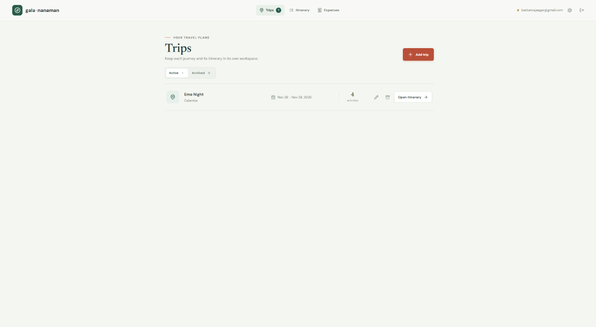
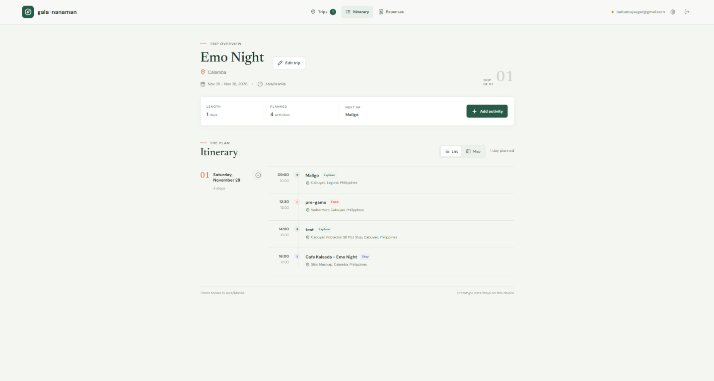
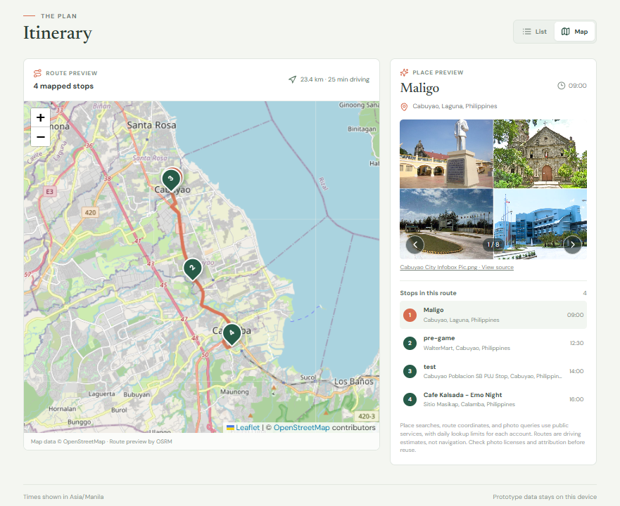
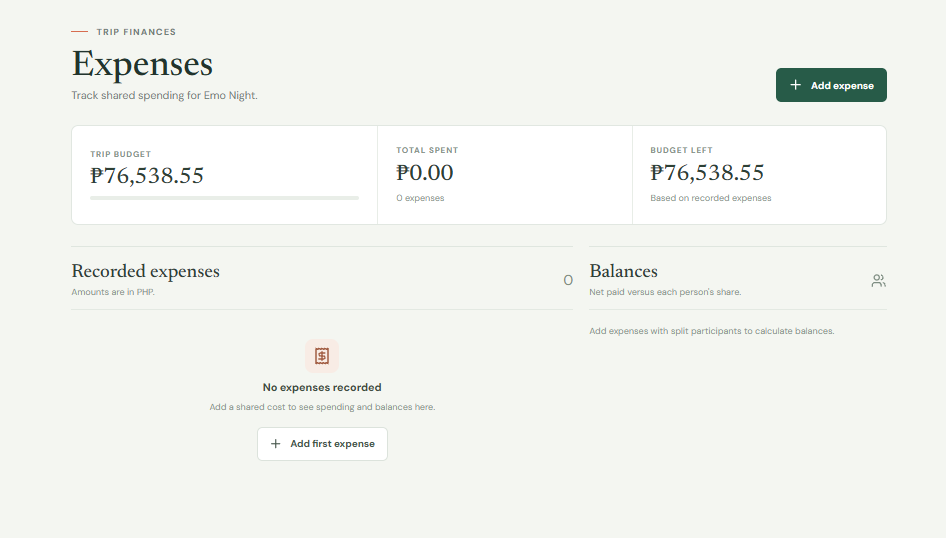

# Gala-Nanaman

> **A mobile-first travel planning application for organizing trips,
> coordinating with companions, and keeping the whole journey in one
> place.**

Gala-Nanaman is a travel planner for solo and group trips. It brings trip
details, destinations, itineraries, maps, accommodations, and expenses
together in a single mobile-friendly experience.

The repository contains a working React and TypeScript prototype for trip,
itinerary, map, expense, and currency-conversion workflows. Product scope
and production readiness are still being validated; this is not a
production-ready application.

## Screenshots

| Trips | Itinerary |
|---|---|
|  |  |

| Itinerary map | Expenses |
|---|---|
|  |  |

## Table of Contents

-   [Vision](#vision)
-   [Screenshots](#screenshots)
-   [Product Principles](#product-principles)
-   [Planned Features](#planned-features)
-   [Collaboration Model](#collaboration-model)
-   [Offline Strategy](#offline-strategy)
-   [Planned Architecture](#planned-architecture)
-   [Data Model](#data-model)
-   [Technology Direction](#technology-direction)
-   [Running Locally](#running-locally)
-   [MVP Roadmap](#mvp-roadmap)
-   [Key Technical Considerations](#key-technical-considerations)
-   [Project Status](#project-status)

## Vision

Planning a trip often means switching between spreadsheets, maps, chat
conversations, booking confirmations, and expense trackers. Gala-Nanaman
aims to provide one organized workspace where travelers can:

-   Build an itinerary around destinations and travel times.
-   See their plans in both timeline and map views.
-   Coordinate proposed changes with travel companions.
-   Keep track of budgets, expenses, and shared costs.
-   Access previously synchronized trip information when an internet
    connection is unavailable.

The application is intended to support both **solo planning** and
**group trips**.

## Product Principles

1.  **Mobile first:** The primary experience is designed for phones,
    with responsive layouts for larger screens.
2.  **Owner-controlled trip data:** Each trip has one owner who controls
    its authoritative information.
3.  **Collaborative through suggestions:** Participants can propose
    changes without directly editing the trip's official records.
4.  **Online first, offline readable:** The application requires
    connectivity for changes. Previously synchronized information can be
    viewed offline.
5.  **Migration ready:** Application logic depends on repository
    contracts rather than Firestore-specific APIs.

## Planned Features

### Trip Management

-   Create, update, and organize trips.
-   Archive and restore trips without deleting their data.
-   Set trip names, dates, descriptions, and primary destinations.
-   Manage trip participants and their access roles.
-   View upcoming, active, and completed trips.

### Itinerary Planning

-   Add destinations and activities to a trip.
-   Schedule activities with start and end times.
-   Attach on-device photos and optional outfit-of-the-day notes to activities.
-   Organize activities chronologically.
-   Add descriptions, notes, and relevant links.
-   View the itinerary as a timeline or on a map.

### Destinations and Maps

-   Search for places and points of interest.
-   Save destination details to a trip.
-   Store place identifiers and geographic coordinates.
-   Visualize trip destinations on an interactive map.
-   Estimate distances and travel durations between stops.

### Expenses and Budgeting

-   Set an overall trip budget.
-   Convert a trip's currency using a dated reference rate with a confirmation preview.
-   Record expenses and identify the person who paid.
-   Define participants included in an expense.
-   Support equal and custom expense splits.
-   Summarize spending and calculate outstanding balances.

### Reservations and Travel Details

-   Keep accommodation and booking information with the trip.
-   Store reservation references, dates, notes, and confirmation links.
-   Keep useful travel details accessible from the trip overview.

### Group Collaboration

-   Invite participants to a trip.
-   Assign owner, contributor, or viewer roles.
-   Allow contributors to submit suggestions and change requests.
-   Let the owner review, approve, reject, or request changes.
-   Keep a history of important decisions and approved changes.

## Collaboration Model

Gala-Nanaman will use an **owner-controlled model**, rather than
allowing every participant to directly edit shared trip records.

The owner is the only person who can make changes to the authoritative
trip data. Other participants interact with the trip according to their
role.

  Capability                        Owner   Contributor   Viewer
  -------------------------------- ------- ------------- --------
  View trip information              Yes        Yes        Yes
  Suggest a destination              Yes        Yes         No
  Request an itinerary change        Yes        Yes         No
  Submit an expense proposal         Yes        Yes         No
  Review and approve suggestions     Yes        No          No
  Modify official trip records       Yes        No          No
  Manage trip members                Yes        No          No
  Delete the trip                    Yes        No          No

### Suggestion and Approval Workflow

1.  A contributor submits a structured suggestion, such as adding a
    destination or changing an activity's schedule.
2.  The backend validates the request and confirms that the submitter is
    an authorized trip member.
3.  The suggestion is stored separately from the authoritative trip
    records with a **Pending** status.
4.  The owner reviews the proposed change.
5.  The owner can approve, reject, or request revisions.
6.  When approved, the backend validates the request again and applies
    the change to the authoritative records.
7.  The decision and resulting change are recorded in the activity
    history.

Suggested request statuses:

-   `PENDING`
-   `APPROVED`
-   `REJECTED`
-   `CANCELLED`
-   `NEEDS_REVISION`

Suggestions are proposals, not direct database commands. Approval must
be validated and processed by the backend. Approved requests should be
idempotent so that the same request cannot accidentally be applied more
than once.

This model reduces conflicts over official trip data. Multiple
participants may still submit suggestions at the same time, so the
suggestion queue will require controlled writes and validation.

## Offline Strategy

The MVP is **online first**. Offline functionality is intentionally
limited to viewing previously synchronized information.

A Progressive Web App caches versioned static application-shell assets, not
authenticated API responses. Trip snapshots are opt-in, read-only, scoped to a
restored Firebase session and expire seven days after server-verified sync.
Switching off Offline copy clears the snapshot; so do explicit sign-out, account
changes and detected online denial. Offline revocation cannot be checked and local
data is accessible to device/browser users. Expiry is enforced when the app runs,
not as guaranteed timed deletion. Local photos have a separate lifecycle.

  Feature                                 Offline behavior
  --------------------------------------- ------------------
  Previously synchronized trip overview   Read-only
  Cached itinerary                        Read-only
  Saved destination details               Read-only
  Expense summaries                       Read-only
  Submit suggestions                      Unavailable
  Approve or reject suggestions           Unavailable
  Edit trip or itinerary                  Unavailable
  Add or edit expenses                    Unavailable
  Live map search and route calculation   Unavailable

Implementation behavior:

-   Use a service worker to cache the application shell.
-   Use IndexedDB for locally cached trip snapshots.
-   Display the last synchronization time.
-   Clearly indicate when the application is offline.
-   Disable all actions that require server-side writes while offline.
-   Refresh cached data when connectivity returns.
-   Provide a way to clear locally stored trip data.

Offline data is a read-only snapshot, not a second editable source of
truth. Sensitive information should not be cached unless it is necessary
and appropriately protected.

## Local Map Cache and Google Maps Links

Leaflet remains the in-app map. Both map views use the canonical OSM tile URL;
the browser's normal HTTP cache honors the provider's cache headers. The service
worker does not cache map tiles or provider API responses. No offline-area
downloads, tile prefetch, or city/zoom archives are supported.

To save eligible place lookups across visits, sign in, enable **Offline copy**,
then open **Settings > Keep map lookups on this device** and accept the additional
location-history consent. Existing offline consent does not automatically enable
query storage. Persistent results are private to the account in that browser
profile/app installation, not synchronized to other devices.

| Data | Current cache behavior |
| --- | --- |
| OSM tiles | Browser-managed HTTP cache, not app-managed offline maps |
| Photon search | Up to 24 hours; opt-in IndexedDB plus session memory |
| Photon reverse geocoding | Up to seven days; opt-in IndexedDB plus session memory |
| OSRM route estimates | Up to six hours in session memory only, pending persistence-policy review |
| Wikimedia place-photo metadata | Up to 24 hours in session memory only, pending persistence-policy review |
| Personal uploaded photos | Existing separate on-device photo storage; unaffected |

Provider cache directives can shorten freshness or prohibit storage. Expired
results are refreshed rather than silently presented as current. App-managed
lookup storage is capped at 200 entries / approximately 5 MiB per account, with
512 KiB per-entry protection and expired/LRU eviction. Retention never extends
beyond seven days from fetching because of repeated reads. Failed storage falls
back to bounded memory; successful provider results still display. Cached hits
do not consume another daily lookup allowance. These allowances remain advisory.

**Clear cached lookups** removes app-managed query/coordinate results, not trip
records or personal images. Sign-out, account change, offline-consent withdrawal
and detected access denial also revoke and clear this history. A late request
cannot repopulate cleared data. Web Locks reduce duplicate requests across tabs
where supported; otherwise coalescing is per-tab. Expiry/deletion runs when the
app executes and can fail if storage is unavailable. The app cannot guarantee
erasure of browser-managed tile/image HTTP caches; clear browser/device data for
that. Local data is not encrypted against other device users.

Recorded locations offer **Open in Google Maps** and **Directions**. These are
encoded HTTPS Maps URLs, not a Google API/SDK integration: no API key or Maps
Platform API billing is needed. A deliberate click sends the selected location
to Google; trip notes, account IDs and tracking parameters are not included.
Directions omit the origin so Google can ask for or use its own location context.
Its route may differ from OSRM, and its offline availability is not guaranteed.
Native universal-link/system-browser behavior still requires device validation.

Provider references: [OSM tile policy](https://operations.osmfoundation.org/policies/tiles/),
[Photon public demo](https://github.com/komoot/photon#demo-server),
[OSRM policy and operator referrals](https://github.com/Project-OSRM/osrm-backend/wiki/Api-usage-policy),
[Google Maps URLs](https://developers.google.com/maps/documentation/urls/guide).

## Planned Architecture

The MVP uses a React and TypeScript application with Firebase
Authentication and Cloud Firestore. Firestore Security Rules enforce
owner-only access at the data boundary.

``` text
                   Mobile / Desktop Browser
                              |
                              v
                 React + TypeScript PWA
                 - Trip and itinerary UI
                 - Owner approval dashboard
                 - Contributor suggestions
                 - Offline read-only cache
                              |
                              v
                      Application Services
                      - Trip and itinerary rules
                      - Expense calculations
                      - Input validation
                              |
                              v
                          TripRepository
                      - Browser adapter (development only)
                      - Firestore adapter
                              |
                              v
                      Firebase Authentication
                      Firestore Security Rules
                              |
                              v
                            Cloud Firestore

                 External Integrations
                 - Google Maps Platform
                 - Places and route services
```

### Architectural Boundaries

The frontend should communicate with application services through
defined contracts. Business rules should not be implemented inside UI
components.

Application services depend on repository interfaces rather than directly
accessing Firestore. The Firestore adapter translates domain operations
to documents and subcollections.

For example, application logic should call a method such as:

``` ts
tripRepository.getById(tripId);
```

It should not directly call Firebase client APIs or manipulate Firestore
documents.

This separation keeps storage operations replaceable and testable.

### Firebase Authentication and Firestore

Google Authentication establishes the signed-in user. Firestore stores
trips under stable IDs, with activities and expenses in per-trip
subcollections. The backend derives the owner UID from the verified
Firebase session; the client must not choose an owner identity.

Firestore Security Rules require authentication and allow access only
when the signed-in UID matches the trip's `ownerId`. Subcollection rules
check ownership of the parent trip. Every production operation must be
covered by these rules; hiding controls in the UI is not authorization.

The Firebase web configuration is not a secret. Security depends on
Firebase Authentication, restrictive Firestore Rules, and correctly
configured project access. Keep service-account credentials out of the
browser and repository.

## Data Model

The initial logical data model is expected to include the following
entities:

  -----------------------------------------------------------------------
  Entity                              Responsibility
  ----------------------------------- -----------------------------------
  `Users`                             User identity and profile
                                      information

    `Trips`                             Main trip records, owner reference,
                                                                            and archive state

  `Trip_Members`                      Trip membership and participant
                                      roles

  `Destinations`                      Saved places and geographic
                                      metadata

  `Itinerary_Items`                   Scheduled activities and
                                      destination references

  `Suggestions`                       Proposed changes submitted by
                                      participants

  `Expenses`                          Actual expense records and payer
                                      information

  `Expense_Splits`                    Allocation of expenses among
                                      participants

  `Reservations`                      Accommodation, transport, and
                                      activity booking details

  `Activity_Log`                      Important actions, approvals, and
                                      decisions

  `Settings`                          Application-level configuration
  -----------------------------------------------------------------------

### Data Design Rules

-   Use stable unique IDs to identify records; never depend on row
    positions or storage order.
-   Store relationships through IDs rather than relying on row
    positions.
-   Keep suggestions separate from authoritative trip records.
-   Store timestamps consistently and retain the trip's relevant
    timezone.
-   Preserve Google Maps Place IDs when available, along with
    coordinates and the place details needed by the application.
-   Validate references before applying changes.
-   Record important owner decisions and changes in an activity log.
-   Keep storage-specific logic inside repository adapters.

## Technology Direction

| Area | Technology | Purpose |
| --- | --- | --- |
| Frontend | React and TypeScript | Trip, itinerary, map, and expense UI |
| Authentication | Firebase Authentication | Google sign-in and verified user identity |
| Data store | Cloud Firestore | Owner-scoped trip, activity, and expense records |
| Development fallback | Browser local storage | Local prototype only; not used in production builds |
| User preferences | Browser local storage | Time display and default currency for new trips |
| Currency conversion | Frankfurter API | Current reference rate fetched only when converting a trip |
| Activity photos | IndexedDB | Manual image attachments stored on this device only |
| Maps | OpenStreetMap, Photon, OSRM demo | Prototype place search, tiles, and driving estimate |
| Photos | Wikimedia Commons | Prototype place imagery with source links |
| Usage limits | Browser-enforced daily limits per account | Fair-use caps for place, route, and photo lookups |
| Rule tests | Firebase Emulator and Rules Unit Testing | Verify owner-only database access |
| Unit tests | Vitest | Currency conversion and usage-limit logic |
| Offline support | IndexedDB and service worker | Opt-in seven-day read-only snapshots; authenticated/native release checks pending |
| Version control | GitHub | Source code and project documentation |

Map, routing, and photo providers are prototype choices, not production
availability guarantees. Firebase project configuration and deployed
Firestore Rules are required before production use.

## Running Locally

Prerequisites: Node.js 20.11 or newer and npm. Java 11 or newer is
required for the Firestore emulator rules test.

``` sh
npm install
npm run dev
```

Run the type check and production build with:

``` sh
npm run build
```

Run the unit tests with `npm test`.

### Firebase development and production projects

Use separate Firebase projects for development and production so test data
and accounts stay separate from live data. Register a web app, enable Google
Authentication, create a Cloud Firestore database, and configure authorized
domains in each project. Add `localhost` and the development Hosting domain
to the development project's authorized domains; add the production Hosting
domain to the production project.

Create `.env.development.local` and `.env.production.local` in the project
root, using `.env.example` as a template. Fill each file with that
environment's Firebase web app settings. Keep these files out of version
control. Vite selects the matching file for each build mode; the Firebase web
configuration is public, and Firestore Rules are the security boundary.

The Firebase CLI project aliases are stored in `.firebaserc`. This repository
uses `dev` for `gala-nanaman-dev` and `prod` for `gala-nanaman`. To configure
aliases in another checkout, run `npx firebase-tools login`, then
`npx firebase-tools use --add` once for each project and assign the aliases
`dev` and `prod`.

Build and deploy to development with:

```sh
npm run check
npx vite build --mode development
npx firebase-tools deploy --only hosting --project dev
npx firebase-tools deploy --only firestore:rules --project dev
```

Build and deploy to production with:

```sh
npm run build
npx firebase-tools deploy --only hosting --project prod
npx firebase-tools deploy --only firestore:rules --project prod
```

`npm run build` uses Vite's production mode. Firebase Hosting serves the
generated `dist` directory; keep the Vite entry point at the project root.
Hosting and Firestore Rules deploy separately. Double-check the target alias
before deploying, especially to `prod`.

The workflow at `.github/workflows/firebase-hosting-merge.yml` automatically
builds and deploys the production site to Firebase Hosting after changes are
pushed or merged to `main`. In GitHub, add the production web app values as
Actions secrets named `VITE_FIREBASE_API_KEY`,
`VITE_FIREBASE_AUTH_DOMAIN`, `VITE_FIREBASE_PROJECT_ID`, and
`VITE_FIREBASE_APP_ID` under **Settings → Secrets and variables → Actions →
Secrets**. These Firebase web settings are public client configuration and
will be included in the deployed app bundle.
The workflow also requires the
`FIREBASE_SERVICE_ACCOUNT_GALA_NANAMAN` Actions secret used to authorize
Firebase Hosting deployment. In the Firebase console for `gala-nanaman`, open
**Project settings > Service accounts > Firebase Admin SDK > Generate new private key**.
Treat the downloaded JSON as a private credential. In this GitHub repository,
open **Settings > Secrets and variables > Actions > New repository secret**,
name it `FIREBASE_SERVICE_ACCOUNT_GALA_NANAMAN`, and paste the complete JSON
contents as its value, not a file path. Do not paste `.env` contents or
`VITE_FIREBASE_*` assignments into this secret; keep the four web configuration
values in their separate secrets. An `Unexpected token 'V'` / `not valid JSON`
authentication error means the deployment credential is not valid JSON. Edit
the existing `FIREBASE_SERVICE_ACCOUNT_GALA_NANAMAN` repository secret and
replace its value with the complete service-account JSON, then rerun the workflow.
Use a repository secret, not an Actions
variable; the deployment jobs do not select a GitHub environment. Never commit
the key or print it in logs. Both Hosting workflows pass this secret directly
to the action's `firebaseServiceAccount` input. If that input is reported as
missing, verify the secret exists and is available to the run, then rerun the
workflow. Fork pull requests are excluded from preview deployment, and GitHub
does not provide Actions secrets to Dependabot pull requests.
A missing web configuration secret causes
the build step to fail instead of deploying an app that cannot connect to
Firebase.

With Java 11 or newer installed, run `npm run test:rules` to check owner
isolation and data validation.

The app does not use Cloud Functions, so no paid plan is required.

Without Firebase settings, the Vite development server uses browser-local
prototype storage. Production builds refuse to run without Firebase
configuration. Do not enter sensitive personal or booking information in
local prototype mode. Map previews use public OpenStreetMap, Photon, OSRM
demo, and Wikimedia Commons services; queries and coordinates are sent to
those providers, and routes are not for navigation. Activity photo blobs
remain in this browser's IndexedDB and are not uploaded or synced to other
devices. Currency conversion sends only the source and target currency codes
to Frankfurter; trip and expense details are not sent. Converted amounts use
the latest available reference rate and may differ from a payment provider's rate.

## Mobile Builds

The app is wrapped with Capacitor 7. Android APK builds can be created on
Windows with Android Studio, Android SDK, and JDK 17. iOS builds require
macOS, Xcode, and Apple signing. The native app ID is
`com.galananaman.travel`.

### Android APK

1. Install Android Studio and JDK 17, then configure the Android SDK.
2. Register an Android app with the native app ID in Firebase. Enable Google
    sign-in, add the app's SHA-1 fingerprint in Firebase project settings, and
    download `google-services.json` to `android/app/`. The file is ignored by
    Git. Add the Play App Signing SHA-1 as well before distributing through
    Google Play.
3. Generate the Android project with `npm run mobile:add:android`.
4. Add `rgcfaIncludeGoogle = true` and
    `androidxCredentialsVersion = '1.3.0'` inside the `ext` block in
    `android/variables.gradle`, then run `npx cap update android`.
5. Build and copy the app with `npm run mobile:sync:android`.
6. Open the project with `npx cap open android`. In Android Studio, use
    **Build > Build Bundle(s) / APK(s) > Build APK(s)** for a sideloadable APK.
    Use a signed release build for distribution.

### iOS

1. On a Mac, register an iOS app with the native app ID in Firebase. Enable
    Google sign-in and download `GoogleService-Info.plist` to `ios/App/`. The
    file is ignored by Git.
2. Generate the iOS project with `npm run mobile:add:ios` and build/copy the
    app with `npm run mobile:sync:ios`.
3. In Xcode, add the `REVERSED_CLIENT_ID` from the plist as a URL scheme,
    configure your Apple development team, then run on a device or archive for
    distribution.

Native Google sign-in exchanges its ID token with Firebase JS Auth, which is
used by the existing Firestore repository. Firebase web settings in
`.env.local` are still required. For Android, run `gradlew signingReport` in
the `android` directory to find the debug SHA-1 before configuring Firebase.

## Mobile Builds

The app is wrapped with Capacitor 7. Android APK builds can be created on
Windows with Android Studio, Android SDK, and JDK 17. iOS builds require
macOS, Xcode, and Apple signing. The native app ID is
`com.galananaman.travel`.

### Android APK

1. Install Android Studio and JDK 17, then configure the Android SDK.
2. Register an Android app with the native app ID in Firebase. Enable Google
    sign-in, add the app's SHA-1 fingerprint in Firebase project settings, and
    download `google-services.json` to `android/app/`. The file is ignored by
    Git. Add the Play App Signing SHA-1 as well before distributing through
    Google Play.
3. Generate the Android project with `npm run mobile:add:android`.
4. Add `rgcfaIncludeGoogle = true` and
    `androidxCredentialsVersion = '1.3.0'` inside the `ext` block in
    `android/variables.gradle`, then run `npx cap update android`.
5. Build and copy the app with `npm run mobile:sync:android`.
6. Open the project with `npx cap open android`. In Android Studio, use
    **Build > Build Bundle(s) / APK(s) > Build APK(s)** for a sideloadable APK.
    Use a signed release build for distribution.

### iOS

1. On a Mac, register an iOS app with the native app ID in Firebase. Enable
    Google sign-in and download `GoogleService-Info.plist` to `ios/App/`. The
    file is ignored by Git.
2. Generate the iOS project with `npm run mobile:add:ios` and build/copy the
    app with `npm run mobile:sync:ios`.
3. In Xcode, add the `REVERSED_CLIENT_ID` from the plist as a URL scheme,
    configure your Apple development team, then run on a device or archive for
    distribution.

Native Google sign-in exchanges its ID token with Firebase JS Auth, which is
used by the existing Firestore repository. Firebase web settings in
`.env.local` are still required. For Android, run `gradlew signingReport` in
the `android` directory to find the debug SHA-1 before configuring Firebase.

## MVP Roadmap

The sequence below was proposed at MVP inception. Prototype feature work is
underway; complete Phase 0 before using real trip data or treating the app as
production-ready.

The proposed first release lets an authenticated trip owner manage trips,
chronological itineraries, day completion, manually attached local photos
and outfit-of-the-day notes, place previews, driving-route estimates, and
shared expenses with equal or custom splits. This milestone adds completed-day
memories and opt-in offline viewing. It excludes group membership and suggestion
approvals, reservations, offline writes and cloud photo synchronization.
These remain future product capabilities.

### Phase 0 --- Validate the MVP assumptions

-   [ ] Confirm the first-release scope and explicit deferrals described
    above.
-   [ ] Configure Firebase Authentication with Google sign-in and create a
    Firestore database for the project.
-   [ ] Deploy `firestore.rules` and pass the two-account owner-isolation
    tests before using real trip data.
-   [ ] Agree on trip date, timezone, itinerary time, expense currency,
    and split-rounding semantics.
-   [ ] Document Firestore export/restore and verify recovery before
    storing real trip data.
-   [ ] Confirm production maps, routing, and photo providers, including
    usage limits, attribution, privacy, and cost.
-   [x] Record opt-in seven-day snapshot expiry and clear-on-sign-out policy.
-   [ ] Validate that policy on the supported browsers/native devices.

As the sole developer, record the outcome and pass/fail evidence for each
gate before using real trip data or shipping the dependent functionality.

### Phase 1 --- Foundation

-   [x] Initialize a React and TypeScript application shell.
-   [x] Establish responsive prototype layouts for mobile and desktop.
-   [x] Define the `TripRepository` contract and Firestore adapter.
-   [x] Add Google sign-in and Firestore owner rules.
-   [x] Validate trip, activity, and expense writes in Firestore Rules.
-   [ ] Configure Firebase project values and authorized domains.
-   [x] Run the Firestore emulator rules suite with Java installed.

Local evidence and remaining Phase 0/1 blockers are recorded in
[release gates](docs/RELEASE_GATES.md). Deployment, real-account verification,
scope approval and recovery rehearsal remain open.

### Phase 2 --- Core trip and itinerary

-   [x] Create, view, and update trips.
-   [x] Archive and restore trips without deleting their activities or expenses.
-   [x] Add, view, update, and remove itinerary activities.
-   [x] Display activities chronologically with configurable 12/24-hour time.
-   [x] Default new activity times one hour after the preceding stop.
-   [x] Mark itinerary days complete.
-   [x] Attach local photos and outfit-of-the-day notes to activities.
-   [x] Add expenses from itinerary activities and show linked spend inline.
-   [x] Configure the default currency for new trips, including PHP.

### Phase 3 --- Collaboration

Design proposal: [owner-controlled collaboration](docs/COLLABORATION.md).
Implementation remains deferred; billing, invitations and review-policy decisions
must be approved before changing owner-only access.

-   [ ] Implement owner, contributor, and viewer roles.
-   [ ] Allow contributors to submit suggestions.
-   [ ] Build the owner's approval dashboard.
-   [ ] Implement approval, rejection, and revision workflows.
-   [ ] Record important decisions in the activity log.

### Phase 4 --- Offline Viewing

-   [x] Add static PWA application-shell caching.
-   [x] Add opt-in, account-scoped seven-day IndexedDB snapshots.
-   [x] Implement read-only offline views and local photo viewing.
-   [x] Display synchronization status and timestamps.
-   [x] Guard server-dependent actions while offline without queuing writes.
-   [ ] Complete authenticated cold-start, native-device and privacy release checks.

### Secure Offline Travel Memories

Completed days from active and archived trips appear in Memories with a calendar,
activity timeline and manual photo carousel. Unmarking a day removes it; edits or
deletions update the live memory rather than preserving an immutable archive.
Next day advances an activity's date without replacing editable custom times.
Recap summaries derive from recorded completed-day data, not verified visits or
invented photo timestamps. Rewind playback is not implemented.

Images are limited to 30 MiB each (five activity images plus one outfit image).
JPEGs are compressed on-device to WebP when supported and smaller; other formats
remain unchanged to preserve animation/transparency. Image files stay in IndexedDB;
only reference metadata syncs. Another device may show unavailable photos. Clearing
browser data or eviction can lose photos; trip snapshots and Firestore exports are
not photo backups. No silent cloud-upload fallback exists. Storage failures retain
the draft for retry rather than discarding selected images.

Forms provide inline validation and persisted-result feedback. Inputs use structured
Firestore SDK calls and encoded query parameters, not executable query strings.
Browser-only validation/fair-use limits do not replace server authorization.

### Phase 5 --- Maps and Expenses

-   [x] Add prototype place search and a route map using public services.
-   [x] Show place imagery in a source-linked photo carousel.
-   [x] Record trip budgets and expenses in the trip currency.
-   [x] Support equal and custom expense splits with settlement summaries.
-   [x] Convert trip currency with a dated reference-rate confirmation.
-   [x] Limit place, route, and photo lookups per account per day.
-   [ ] Select production maps, routing, and photo providers.
-   [ ] Add travel modes and route details beyond the driving preview.

## Key Technical Considerations

### Authentication and Authorization

Firebase Authentication establishes the signed-in user. Firestore Rules
authorize access by comparing the verified `request.auth.uid` with the
trip's `ownerId`. The client must never supply an owner ID as proof of
identity.

The client uses Firebase's public web configuration; no service-account
credential belongs in the browser or repository. Keep the Firebase project
locked to the deployed domains, enable only the required sign-in provider,
and deploy restrictive Firestore Rules before using real data.

### Concurrent Requests

Firestore rules prevent users from writing outside their own trip. They do
not make a sequence of writes across trip and subcollection documents
atomic. Keep operations idempotent and use transactions or batched writes
when a future workflow spans multiple documents.

Apply owner authorization in Firestore Rules for every trip, activity, and
expense read or write. Client-side checks are only for presentation and do
not replace these rules.

### Firestore Operations and Recovery

The current data layout stores a trip document with activity and expense
subcollections. The UI loads those subcollections per trip, so monitor read
volume, quotas, and cost as trip counts grow. Use stable document IDs for
retryable writes and validate the owner rules in the emulator.

### Maps API Usage

The prototype uses public OpenStreetMap tiles, Photon place search, the
OSRM demo routing service, and Wikimedia Commons image search. These
services have usage policies and no production availability guarantee.
Before release, choose supported providers, review privacy and licensing,
add appropriate caching and attribution, and monitor quotas and costs.

### Usage Limits on the Free Plan

Each account can make up to 200 place searches, 100 route requests, and
100 photo searches per day in each browser. Repeated lookups in the same
session are served from memory and do not count again. Limits reset at
local midnight and are set in `src/services/usageLimits.ts`.

These are fair-use limits enforced by the app, not a security boundary.
Map, routing, and photo services are called directly from the browser, so
someone could bypass the limits by calling those public services directly.
Firestore free-tier quotas are shared by the whole project. Firestore Rules
restrict each account to its own data and validate document shapes and
sizes, but they cannot cap per-account reads. Server-enforced per-account
quotas require an authenticated proxy, such as Cloud Functions on the Blaze
plan.

### Backups and Data Portability

Firestore's managed export and import service requires billing, so it is
not available on the Spark plan. Before storing real trip data, choose a
backup method, such as an Admin SDK export script run from a trusted
machine, and rehearse a restore. Use the repository boundary to keep
application rules independent of Firestore-specific document layouts.

## Project Status

**Current stage: Firebase-backed implementation in progress.**

The prototype includes Google sign-in, a Firestore repository adapter,
owner-only Firestore Rules, itinerary and expense management, activity and
outfit photos, and daily fair-use limits for map lookups. Trip archiving is
reversible and preserves nested records. Currency conversion uses a dated
reference rate. It targets the no-cost Spark plan. Preferences and activity
photo blobs remain on the device and are not synced. Firebase project values
are not configured in the repository; local rules-emulator tests require
Java, while CI is configured to run them with Java 17. The browser-local
adapter is for development only. Complete Phase 0 and verify the rules suite
before using real trip data. Collaboration is design-only; read-only offline
viewing and memories are implemented, with release gates tracked separately.

------------------------------------------------------------------------

Gala-Nanaman is intended to make trip planning more organized,
collaborative, and manageable---without giving up clear ownership and
control over the final plan.
